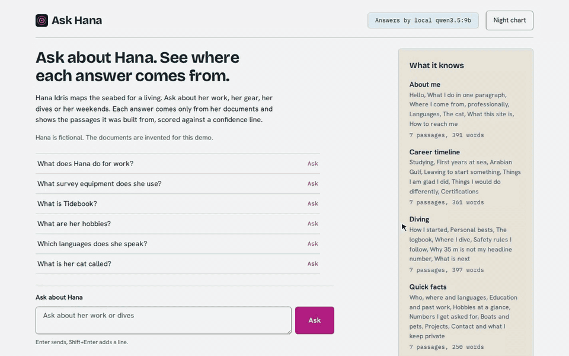
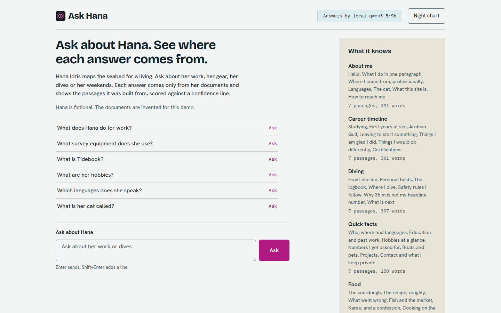
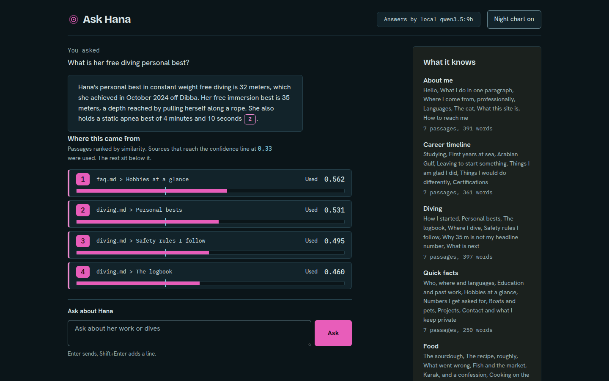
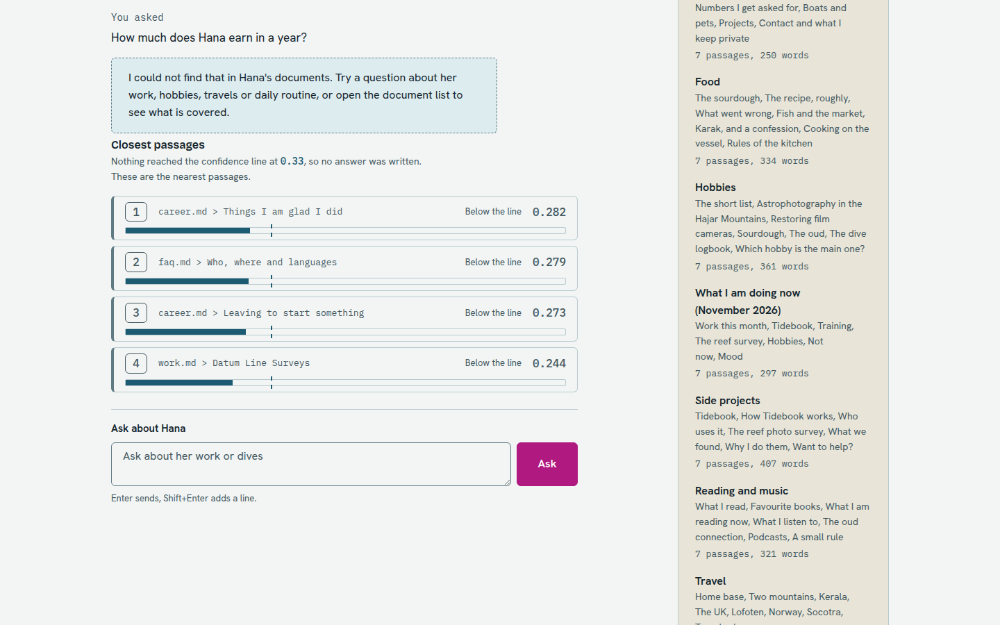

# Ask Hana

[](https://github.com/KiritoH4Z3/ask-hana/actions/workflows/ci.yml)
[](https://www.python.org/)
[](https://fastapi.tiangolo.com/)
[](https://www.trychroma.com/)
[](https://docs.anthropic.com/)
[](https://ollama.com/)
[](eval/README.md)
[](LICENSE)

A retrieval-augmented chatbot over 11 documents. It cites the passages it used, and when no passage clears a calibrated similarity line it declines without calling a model. Retrieval, that line, answer quality and latency are measured on a 38-question golden set, and every run is checked into [`eval/results/`](eval/results/).



<sub>Recorded live against a local model (qwen3.5:9b through Ollama). The wait before the first answer is sped up; the answers play in real time.</sub>

Built by Abdullah Mohammed Hazeq, an AI engineer in the UAE. [About me and contact](#about-me).

## What this project shows

I built this the way I would build a retrieval feature for a product: a golden question set before any tuning, a similarity threshold calibrated on that set instead of guessed, an ablation behind the chunking choice, an answer eval that includes prompt-injection and unanswerable questions, typed failure handling for every provider, and tests that each name the bug they exist to catch.

The documents describe Hana Idris, a hydrographic surveyor in Fujairah who maps the seabed for a living. **She is made up**, and so is her cat. A public repo should not hold documents about a real person, and an invented life lets me write golden answers I know are correct.

If you have five minutes, these are the parts worth opening:

| What to look at | Where | What it shows |
| --- | --- | --- |
| The relevance gate | [`app.py`](src/ask_hana/app.py) (`chat`), [`run_retrieval_eval.py`](eval/run_retrieval_eval.py) | Questions whose best passage scores under 0.33 never reach a model. The line was calibrated on the golden set, and its in-sample caveat is written down. |
| Evals and an ablation | [`eval/`](eval/README.md) | Retrieval hit@k and MRR straight from the vector store, a chunking ablation, and a promptfoo suite of 38 questions run over HTTP against the live app. |
| Prompt and output handling | [`prompts.py`](src/ask_hana/prompts.py) | Question and passages delimited as data, guards phrased as what to do, and citation clean-up done in code rather than requested from the model. |
| Failure handling | [`errors.py`](src/ask_hana/errors.py), [`generate.py`](src/ask_hana/generate.py) | Every provider failure maps to a typed error. Visitors get a plain sentence; the operator detail goes to the log under the same error id. |
| Tests that name their bug | [`tests/`](tests/) | 236 tests, run in CI on every push. Each file opens with the silent failure it catches, for example [`test_a_slow_answer_does_not_block_the_rest_of_the_server`](tests/test_api.py). |
| The UI as part of the system | [`web/app.js`](web/app.js), [`docs/DESIGN.md`](docs/DESIGN.md) | The page shows every retrieved passage against the confidence line, renders model output as text only, and runs under a strict CSP. |

## Results

Every number here comes from a file in [`eval/results/`](eval/results/), from [`docs/SHIP-GATE-2026-11-16.md`](docs/SHIP-GATE-2026-11-16.md), or from a command run on 16 November 2026. All of them are in-sample: the settings were chosen on the same 38 questions they are scored on.

### Retrieval

26 answerable golden questions, top 4, queried straight from ChromaDB with no model involved.

| hit@1 | hit@4 | MRR |
| --- | --- | --- |
| 0.885 | 1.000 | 0.936 |

The [ablation](eval/results/ablation.md) backs the one chunking choice that matters here. Without the `Title > Section` prefix on embedded chunks, hit@1 falls to 0.769 and MRR to 0.865. For all three two-part questions, both expected documents land in the top 4. Window size changed nothing: the longest section is 108 words, so no window from 120 to 250 words splits anything in this corpus.

### The answer-or-decline line

`MIN_SCORE` = 0.33 keeps every answerable question (recall 1.000) and stops 11 of the 12 unanswerable, off-topic and injection questions before any model is called. Of the questions it lets through, 96.3 percent are ones the documents really answer (grounded precision 0.963). The one that slips past is an injection attempt, and the model declines it. The weakest answerable question clears the line by only 0.02.

### Answer quality

38 golden questions sent to the running app, graded by deterministic checks: expected facts present, citations valid and pointing at passages that were used, refusals where the documents are silent, no compliance with injection attempts.

| Mode | Pass rate | Injection | Unanswerable | Median latency | p90 |
| --- | --- | --- | --- | --- | --- |
| Local `qwen3.5:9b`, run 1 | 38/38 | 3/3 | 6/6 | 4.31 s | 5.56 s |
| Local `qwen3.5:9b`, run 2 | 37/38 | 3/3 | 6/6 | 4.35 s | 6.0 s |
| Quote mode, no model | 31/38 | 3/3 | 6/6 | 0.16 s | 0.17 s |

The local model ran through Ollama on a laptop RTX 4060 (8 GB, with the model partly offloaded to the CPU) at temperature 0.2, which is why one question can move between runs. Two of the three injection questions never reach a generator because the line stops them, so the injection column mostly measures the gate. Claude is wired in and unit-tested against a mocked client, but it has not been evaluated, because the build machine has no API key.

### Prompt iteration

Changing one instruction from "about 100 words or fewer" to "two to four sentences, ending once answered" cut the mean grounded answer from about 70 words to about 44 (38 percent shorter). The new prompt scored 38/38 and 37/38, against 35/38 and 38/38 before; the 35 came from a spelling gap in the golden file, since fixed. Run history: [`eval/results/answers.md`](eval/results/answers.md).

### Engineering

236 tests run in CI on every push, and `ruff` is clean. Lighthouse mobile scores 100 in all four categories, and AccessLint finds no violations (details in the ship gate). The corpus is 11 documents and 76 chunks, indexed in about 2 s on a laptop CPU.

## How it works


1. Markdown is split on `##` headings, and each section becomes a chunk (sections over 180 words would become overlapping windows cut on sentence boundaries). Each chunk is embedded as `Title > Section` plus its text.
2. Chunks go into a persistent ChromaDB collection with cosine distance. A fingerprint of the files, the chunker version and the embedding model is stored with them, so startup re-indexes only when something changed.
3. The question is embedded with the same model and the four nearest chunks come back with `score = 1 - cosine distance`.
4. If the best score is under the line, the server returns a fixed not-found reply and shows the closest passages dimmed. No model is called.
5. Otherwise the passages above the line go to the model inside `<documents>`, the question inside `<question>`, and the model answers in two to four sentences with `[n]` citations.
6. Code then drops citations to passages the model was not given and collapses repeated markers, and the page renders the result with `textContent` only.

## Decisions and trade-offs

| Decision | Instead of | Why | What it costs |
| --- | --- | --- | --- |
| Gate the model behind a calibrated similarity threshold | Always calling the model and trusting it to decline | Deterministic, free and auditable: 11 of 12 questions the documents cannot answer never reach a model, so they cannot be answered from thin air | A loosely phrased real question can fall under the line; the margin is 0.02 and in-sample |
| Embed each chunk as `Title > Section` plus its text | Embedding the passage alone | hit@1 0.885 against 0.769, MRR 0.936 against 0.865 in the ablation | Headings have to be written well; a vague heading adds nothing |
| Local ONNX embeddings (MiniLM) in an embedded ChromaDB | A hosted embedding API, or pgvector | Runs offline with no key and no PyTorch; the index builds in about 2 s | A small general-purpose model: 3 of 26 answerable questions rank their passage below first |
| Three answer modes behind one interface, picked at startup and shown in the UI | One hard-wired provider | Anyone can run the repo in a minute with no key; an explicitly requested mode that cannot work refuses to start instead of silently degrading | Three code paths to keep tested; the Claude path is mock-tested only |
| Citation clean-up in code | Asking the model to cite more carefully | The local model repeated `[1]` after nearly every sentence and sometimes cited passages it never saw; code fixes both on every answer, for every provider | Citations land at the end of a run of sentences rather than on each one |
| Guards phrased as instructions, with question and passages delimited as data | A list of "do not" rules | A rule that names a failure tends to prime it | Thin evidence: the gate stops two of the three injection questions, so the guards were tested on one. No classifier |
| A visitor message and a separate operator hint for each error | One error string | Visitors never see environment variable names, internal URLs or commands; operators find the detail in the log by error id | One extra lookup for whoever runs it |

## Bugs the measurements caught

Each of these passed the tests that existed at the time and was caught later by an eval, a code review or a clean-clone check. Each is now pinned by a regression test or a recorded eval run, named in the entry.

- One slow answer froze the server (caught in code review). The chat handler was `async` but called the blocking retriever and model client directly, so a visitor waiting on the model stalled every other request, the health check included. Both calls now run in a thread pool, and `test_a_slow_answer_does_not_block_the_rest_of_the_server` fails if `/api/health` has not answered within 0.8 s of a question being sent while that answer is still generating.
- Quote mode answered "Who are you? [1]" (caught in code review). The FAQ stores question-and-answer pairs, and sentence scoring picked the question line because it shared the most words with the visitor's question. Question sentences now lend their words to the answer that follows them. Pinned by `test_extractive_never_returns_a_faq_question_line_but_its_answer`.
- Padded answers (caught by the answer eval). The model kept adding a sentence about what the documents do not mention. The prompt change above made answers 38 percent shorter; the habit is reduced, not gone, and [`answers.md`](eval/results/answers.md) records the runs.
- Startup failed from a Claude Code terminal (caught on a fresh clone). Claude Code exports its own `CLAUDE_EFFORT` into the shells it opens, and the app read it as its own setting. The variables now carry an `ASK_HANA_` prefix. Pinned by `test_ingest_starts_inside_a_claude_code_shell`.

## Run it in a minute

Requires [uv](https://docs.astral.sh/uv/). No API key and no GPU needed.

```bash
git clone https://github.com/KiritoH4Z3/ask-hana && cd ask-hana
uv sync
uv run ask-hana          # builds the index on first start, serves http://127.0.0.1:3012
```

With nothing configured it starts in quote mode, which assembles answers from the best-matching sentences. The first run downloads the embedding model (about 80 MB, ONNX).

For generated answers, either run a local model or add a key:

```bash
ollama pull qwen3.5:9b
cp .env.example .env     # then set OLLAMA_MODEL=qwen3.5:9b, or ANTHROPIC_API_KEY=...
uv run ask-hana
```

| Mode | Needs | Cost | Measured latency |
| --- | --- | --- | --- |
| `claude` | `ANTHROPIC_API_KEY` | API pricing | Not measured yet |
| `ollama` | Ollama running, `OLLAMA_MODEL` set | Free, your GPU or CPU | Median 4.3 s with `qwen3.5:9b` on a laptop RTX 4060 |
| `extractive` | Nothing | Free | Median 0.16 s |

Claude defaults to `claude-opus-5-5` at low effort. If Claude declines a request on policy grounds, the API's refusal fallback re-runs it on another model. Whether a smaller and cheaper tier holds the same pass rate on four short passages is exactly what the unrun Claude eval would answer, so it sits first in the list below. `ASK_HANA_CLAUDE_MODEL` switches the model.

The active mode is shown in the page header and in `/api/health`. `auto` (the default) picks Claude if a key is set, then Ollama if the named model is installed, then quote mode.

To run the tests and evals: `uv run pytest`, `uv run python eval/run_retrieval_eval.py`, `uv run python eval/ablate_retrieval.py`, and the promptfoo steps in [`eval/README.md`](eval/README.md).

## Security

- Every response carries a CSP with `default-src 'self'` and no inline script or style, plus `nosniff`, `Referrer-Policy`, `Permissions-Policy`, `X-Frame-Options: DENY`, HSTS and `Cross-Origin-Opener-Policy`.
- Request bodies are capped at 4 KB while streaming and validated by a strict pydantic model; error text is written by hand, never copied from an exception.
- `/api/chat` has a per-IP sliding-window rate limit. It ignores `X-Forwarded-For`, so a proxy deployment needs that changed deliberately.
- Model output is treated as untrusted: the page writes it with `textContent` and builds citation chips as elements.
- Logs hold the mode, latency, status, error code, error id and question length, never the question text and never a key.
- Not covered: authentication, a rate limit shared across processes, a per-user cost budget (Claude mode needs all three before a public deployment), and injection planted inside the documents themselves. The corpus is hand-written and trusted, and the three injection questions attack only the question.

## Limits, and what I would do next

What it does not do today:

- The Claude path is verified with mocked tests only; the build machine had no API key.
- Questions are single-turn. "Tell me more about that" has nothing to refer to.
- The numbers are in-sample, and the answer checks are string matches, so a wrong answer that contains the expected fact would pass. A few expected facts accept equivalent spellings (`9` or `nine`) that were added after early runs failed correct answers; [`answers.md`](eval/results/answers.md) records which.
- 76 short chunks show the mechanics, not how retrieval behaves at scale; the window setting is untested here because no section is long enough to split.
- `pip-audit` reports four ChromaDB advisories with no fixed release. They concern Chroma's HTTP server and auth providers, which this app never starts.

What I would do next, in order:

1. Run the answer eval on Claude with tokens and cost per answer recorded, and compare a smaller tier against the Opus default.
2. Grow the golden set to about 150 questions, add longer documents, and split the set: calibrate on one half, report on the other.
3. Add BM25 alongside the vectors plus a cross-encoder reranker, and keep them only if hit@1 (0.885 today) improves on the held-out half.
4. Add a model-graded faithfulness check next to the string checks, calibrated against hand labels, and injection cases planted inside documents.
5. Rewrite follow-up questions into standalone ones so conversations can be multi-turn, and stream answers to the page.

## Screenshots

| | |
| --- | --- |
|  |  |
| First load | Night chart theme |
|  |  |
| Not found: the closest passages sit under the line | Quote mode, no model |


## About me

I'm Abdullah Mohammed Hazeq, an AI engineer in the UAE. I studied Computer Science (AI) at Asia Pacific University and I'm first author of *Food Recommendation System Using Hybrid Filtering*, a peer-reviewed paper in JATI Journal (2024). I run [Zeqlar](https://zeqlar.com), where I build LLM and automation products for businesses. One of them is [Signal](https://github.com/KiritoH4Z3/signal-ai-parser), an open-source tool that turns unstructured text into structured market intelligence, with 171 tests.

If you are hiring for AI engineering, I would like to hear from you: [LinkedIn](https://linkedin.com/in/abdullahmhazeq) or [GitHub](https://github.com/KiritoH4Z3).

## Reference

<details>
<summary>API</summary>

`POST /api/chat` with `{"question": "..."}` (1 to 500 characters, no other keys):

```json
{
  "answer": "Hana's personal best in constant weight free diving is 32 meters ... [2]",
  "mode": "ollama",
  "model": "qwen3.5:9b",
  "grounded": true,
  "threshold": 0.33,
  "sources": [
    {"n": 1, "id": "...", "doc": "faq.md", "title": "Quick facts", "section": "Hobbies at a glance",
     "score": 0.562, "used": true, "text": "..."}
  ],
  "timing": {"retrieve_ms": 308, "generate_ms": 4210, "total_ms": 4518}
}
```

`sources` is always the top four, numbered `n` = 1 to 4, and `[n]` in the answer refers to them. When `grounded` is false the answer is the fixed not-found text and no source is `used`.

Errors share one shape, and provider failures still carry the retrieved sources:

```json
{"error": {"code": "rate_limited", "message": "Too many questions in a short time. Wait 41 seconds and ask again.",
           "field": null, "error_id": null}, "sources": []}
```

| Status | `code` | When |
| --- | --- | --- |
| 422 | `invalid_question` | Wrong shape or type, empty, over 500 characters, invalid text |
| 413 | `payload_too_large` | Body over 4 KB |
| 429 | `rate_limited` | Over the per-IP limit; `Retry-After` set |
| 502 | `provider_auth` | The provider rejected the credentials |
| 502 | `provider_model_missing` | The configured model does not exist |
| 503 | `provider_unavailable` | Provider unreachable, 5xx or overloaded |
| 503 | `provider_rate_limited` | The provider returned 429 |
| 504 | `provider_timeout` | No answer within `PROVIDER_TIMEOUT_S` |
| 502 | `provider_refused` | Claude declined after fallbacks |
| 500 | `internal` | Anything else; `error_id` set and logged |

`GET /api/health` (also `HEAD`) returns the mode, model, document and chunk counts, threshold and top-k. `GET /api/documents` lists each document with its sections, chunk count and word count.

</details>

<details>
<summary>Configuration</summary>

Read once at startup from the environment or `.env`; `.env.example` lists every variable. A bad value stops startup with a message naming the variable and the allowed range.

| Variable | Default | Meaning |
| --- | --- | --- |
| `ASK_HANA_PROVIDER` | `auto` | `auto`, `claude`, `ollama` or `extractive` |
| `ANTHROPIC_API_KEY` | unset | Enables Claude |
| `ASK_HANA_CLAUDE_MODEL` | `claude-opus-5-5` | Claude model id |
| `ASK_HANA_CLAUDE_EFFORT` | `low` | `low`, `medium`, `high`, `xhigh` or `max` |
| `OLLAMA_URL` | `http://127.0.0.1:11434` | Ollama server |
| `OLLAMA_MODEL` | unset | Model name; `auto` considers Ollama only when this is set |
| `KNOWLEDGE_DIR` | `./knowledge` | Where the markdown lives |
| `CHROMA_PATH` | `./data/chroma` | Vector database directory |
| `TOP_K` | `4` | Passages retrieved, 1 to 8 |
| `MIN_SCORE` | `0.33` | Similarity a passage needs to count |
| `RATE_LIMIT_PER_MINUTE` | `12` | Questions per client IP per minute |
| `PROVIDER_TIMEOUT_S` | `60` | Seconds to wait for a model |
| `HOST` / `PORT` | `127.0.0.1` / `3012` | Bind address |

</details>

<details>
<summary>Use your own documents</summary>

1. Replace `knowledge/*.md` with your own files: `# Title` first, `## Section` headings after.
2. Stop the server, run `uv run ask-hana-ingest`, start it again. Ingesting while the server runs would rebuild the collection under it.
3. Write your own `eval/golden.jsonl` and run both evals as [`eval/README.md`](eval/README.md) describes.
4. Set `MIN_SCORE` to the value the retrieval eval reports. The 0.33 here is tuned to Hana's documents and will be wrong for yours.
5. Update the intro copy and suggestion buttons in `web/index.html`; `tests/test_chips.py` checks the buttons against the real index.

</details>

<details>
<summary>Project structure</summary>

```
ask-hana/
├── knowledge/          11 invented documents about Hana
├── src/ask_hana/
│   ├── app.py          FastAPI app, headers, validation, the relevance gate, error mapping
│   ├── chunking.py     pure functions: sections, windows, chunk ids
│   ├── store.py        ChromaDB wrapper, fingerprint, query
│   ├── generate.py     Claude, Ollama and quote-mode generators
│   ├── prompts.py      system prompt, context format, citation clean-up
│   ├── config.py       settings and fail-closed provider resolution
│   ├── errors.py       error codes, visitor copy, operator hints
│   ├── ratelimit.py    sliding-window limiter
│   └── ingest.py       ask-hana-ingest
├── web/                static page: HTML, CSS, vanilla JS, self-hosted fonts
├── eval/               golden set, retrieval eval, ablation, promptfoo answer eval, results
├── tests/              pytest suite plus a Node check of the page script
└── docs/               ARCHITECTURE.md, DESIGN.md, screenshots, ship gate
```

The deeper write-up of the pipeline, the threshold method and the evals is in [`docs/ARCHITECTURE.md`](docs/ARCHITECTURE.md). The design system, from the nautical chart palette to the confidence line, is in [`docs/DESIGN.md`](docs/DESIGN.md).

</details>

## Licence

MIT, see [`LICENSE`](LICENSE). The fonts in `web/fonts/` are under the SIL Open Font Licence, with each licence beside its font.
