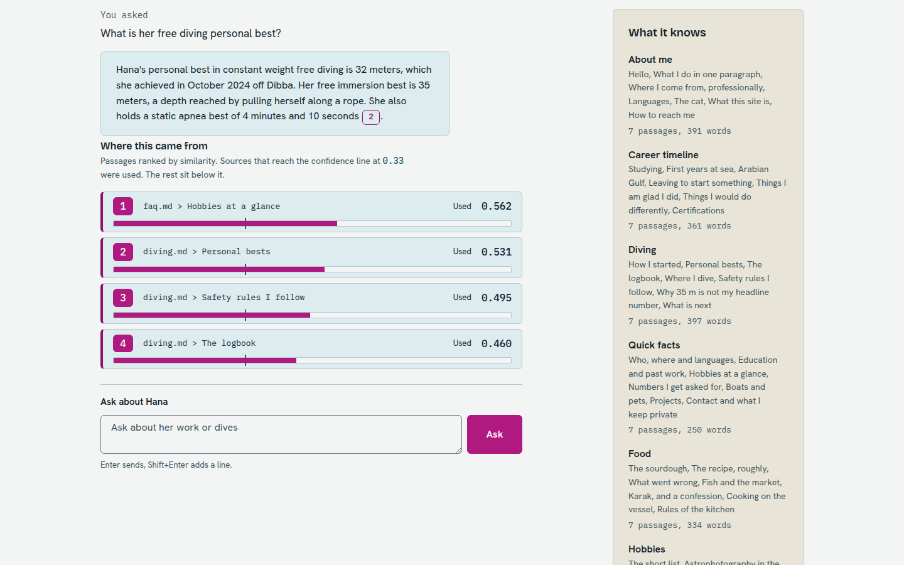
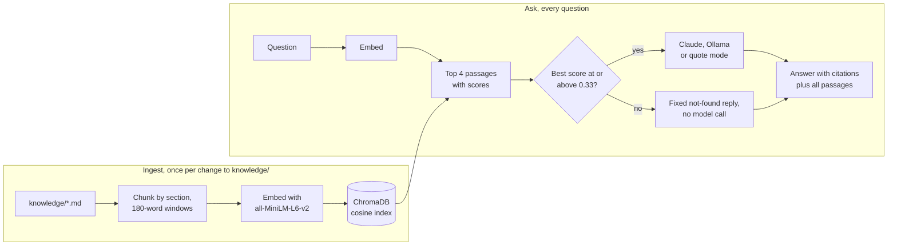
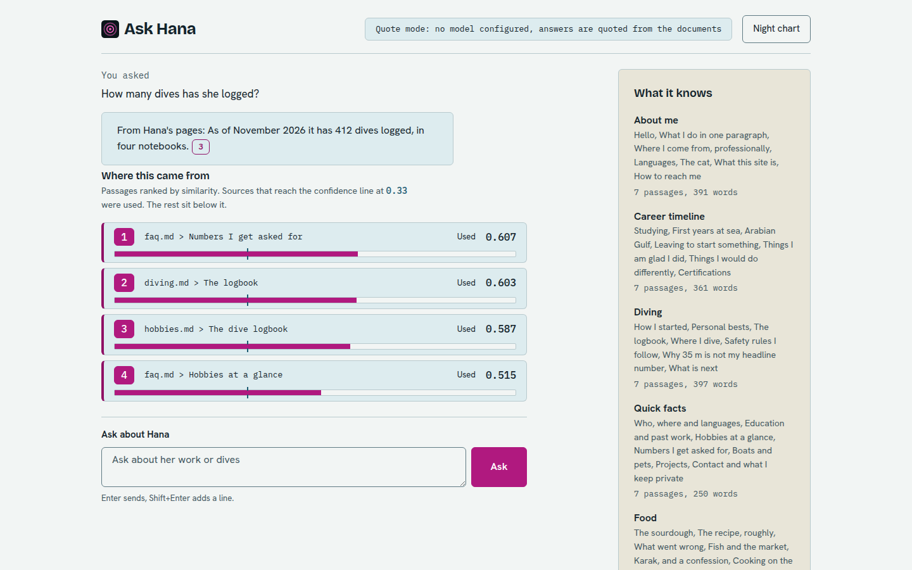
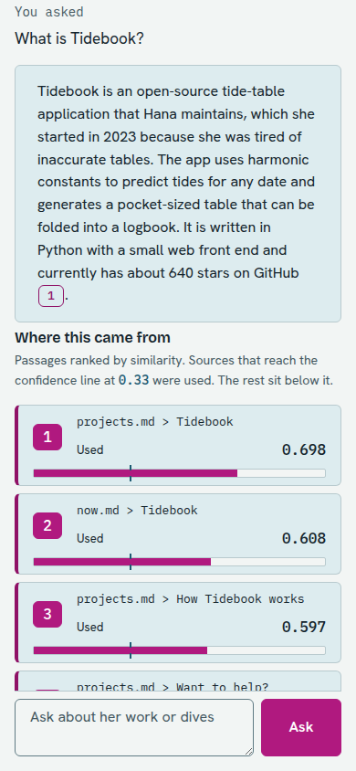

# Ask Hana

[](https://www.python.org/)
[](https://fastapi.tiangolo.com/)
[](https://www.trychroma.com/)
[](https://docs.anthropic.com/)
[](https://ollama.com/)
[](#results)
[](LICENSE)

A chatbot that answers only from a small pile of documents, shows you the passages it used, and says "I could not find that" when the documents do not cover the question.



## What this is

Ask Hana is a retrieval-augmented generation (RAG) demo. Eleven markdown files describe Hana Idris: her work, her dives, her side projects, her cat. Ingestion splits them into passages and stores them in ChromaDB. When you ask a question, the server finds the closest passages, and a model writes a short answer with numbered citations. The page lists every passage it retrieved with its similarity score and draws a confidence line. Passages under the line are dimmed and never reach the model.

**Hana Idris is made up.** She is a fictional hydrographic surveyor (she maps the seabed for a living), and every document in `knowledge/` is invented for this demo. I chose a fictional person on purpose: a public repo should never hold documents about a real one, and a made-up life lets the test questions have clean right answers. Contact details in the documents sit on `example.com`, and the page footer says Hana is fictional.

The point of the project is the engineering around the model: chunking rules, a retrieval threshold that was measured instead of guessed, three answer modes that fail closed, prompt-injection handling, and two evals whose numbers are in this README.

## How it works



1. **Ingest.** `knowledge/*.md` is split on `##` headings. Sections longer than about 180 words become overlapping windows of about 180 words (40 words of overlap), cut on sentence boundaries. Each chunk is embedded as `Title > Section` plus its text.
2. **Index.** Chunks go into a persistent Chroma collection with cosine distance. A fingerprint of the files, the chunker version and the embedding model name is stored beside them, so startup rebuilds only when something changed.
3. **Retrieve.** The question is embedded with the same model and the four nearest chunks come back with `score = 1 - cosine distance`.
4. **Decide.** If the best score is under the threshold (0.33, calibrated on the golden questions), the server answers with a fixed not-found message and does not call a model at all. The closest passages are still shown, dimmed.
5. **Generate.** Passages at or above the line go to the model inside a `<documents>` block, the question inside `<question>`. The prompt tells it to answer from the documents in two to four sentences and cite with `[n]`.
6. **Clean up.** Citation markers that do not match a passage are dropped, runs of the same marker collapse to one, and the page renders everything with `textContent`.

## Three answer modes

| Mode | Needs | Cost | Latency (measured) |
| --- | --- | --- | --- |
| `claude` | `ANTHROPIC_API_KEY` | Anthropic API pricing | Not measured (see [limitations](#honest-limitations)) |
| `ollama` | A running Ollama with a model pulled, `OLLAMA_MODEL` set | Free, uses your GPU or CPU | Median 4.3 s, p90 5.6 to 6.0 s with `qwen3.5:9b` (two runs of 38 questions) |
| `extractive` | Nothing | Free | Median 0.16 s, p90 0.17 s |

Quote mode builds the answer from the sentences of the retrieved passages that share the most words with the question, prefixed with "From Hana's pages:". It cannot reason, so it misses questions whose answer is spread over two passages. It exists so the repo runs for anyone in under a minute with no key and no GPU.

The active mode is always visible in the header badge and in `/api/health`. `auto` picks Claude if a key is set, else Ollama if the named model is installed, else quote mode. An explicit `claude` without a key, or `ollama` without a model name, refuses to start.

## Quickstart

Requires [uv](https://docs.astral.sh/uv/) and Python 3.13 (3.11 and up is accepted by `pyproject.toml`).

```bash
uv sync
uv run ask-hana-ingest   # builds the index from knowledge/
uv run ask-hana          # serves on http://127.0.0.1:3012
```

Open <http://127.0.0.1:3012>. With no other setup the app starts in quote mode.

- The first run downloads the embedding model (about 80 MB, ONNX, cached in your user directory). No torch is installed.
- The server also builds the index on startup when it is missing or stale, so `ask-hana-ingest` is optional. Do not run it while the server is up: it deletes and recreates the collection under the running process. Stop the server, ingest, start it again.

**Use a local model.** Install [Ollama](https://ollama.com/), pull a model, and tell the app its name:

```bash
ollama pull qwen3.5:9b
cp .env.example .env
# in .env: OLLAMA_MODEL=qwen3.5:9b
uv run ask-hana
```

**Use Claude.** Put `ANTHROPIC_API_KEY=...` in `.env` (never commit it; `.env` is gitignored). The default model is `claude-opus-5-5` at `low` effort, with the API's server-side fallback on.

## Configuration

Everything is read once at startup from the environment or `.env`. `.env.example` lists every variable with a safe default.

| Variable | Default | Meaning |
| --- | --- | --- |
| `ASK_HANA_PROVIDER` | `auto` | `auto`, `claude`, `ollama` or `extractive` |
| `ANTHROPIC_API_KEY` | unset | Enables Claude |
| `ASK_HANA_CLAUDE_MODEL` | `claude-opus-5-5` | Claude model id |
| `ASK_HANA_CLAUDE_EFFORT` | `low` | `low`, `medium`, `high`, `xhigh` or `max` |
| `OLLAMA_URL` | `http://127.0.0.1:11434` | Ollama server |
| `OLLAMA_MODEL` | unset | Model name; `auto` considers Ollama only when this is set |
| `KNOWLEDGE_DIR` | `./knowledge` | Where the markdown lives |
| `CHROMA_PATH` | `./data/chroma` | Vector database directory |
| `TOP_K` | `4` | Passages retrieved, 1 to 8 |
| `MIN_SCORE` | `0.33` | Similarity a passage needs to count, 0 to 1 |
| `RATE_LIMIT_PER_MINUTE` | `12` | Questions per client IP per minute |
| `PROVIDER_TIMEOUT_S` | `60` | Seconds to wait for a model |
| `HOST` / `PORT` | `127.0.0.1` / `3012` | Bind address |

A bad value (for example `TOP_K=20`) stops startup with a message that names the variable and the allowed range.

## API

All responses are JSON. The page and the API share one origin; there is no CORS.

### `POST /api/chat`

```bash
curl -s http://127.0.0.1:3012/api/chat \
  -H 'content-type: application/json' \
  -d '{"question": "How many dives has she logged?"}'
```

```json
{
  "answer": "From Hana's pages: As of November 2026 it has 412 dives logged, in four notebooks. [3]",
  "mode": "extractive",
  "model": null,
  "grounded": true,
  "threshold": 0.33,
  "sources": [
    {"n": 1, "id": "...", "doc": "faq.md", "title": "Quick facts", "section": "Numbers I get asked for",
     "score": 0.607, "used": true, "text": "..."}
  ],
  "timing": {"retrieve_ms": 180, "generate_ms": 2, "total_ms": 183}
}
```

`question` is trimmed and must be 1 to 500 characters. Unknown keys, wrong types and empty strings are rejected. `sources` is always the top four in descending score, numbered `n` = 1 to 4, and the `[n]` markers in `answer` refer to those numbers. When `grounded` is `false`, the answer is the fixed not-found text and every source has `used: false`.

Errors share one shape, and provider failures still carry the retrieved `sources`:

```json
{"error": {"code": "rate_limited", "message": "Too many questions in a short time. Wait 41 seconds and ask again.",
           "field": null, "error_id": null}, "sources": []}
```

| Status | `code` | When |
| --- | --- | --- |
| 422 | `invalid_question` | Bad JSON shape, wrong type, empty, over 500 characters, invalid text |
| 413 | `payload_too_large` | Body over 4 KB |
| 429 | `rate_limited` | Over the per-IP limit; `Retry-After` header set |
| 502 | `provider_auth` | The model provider rejected the credentials |
| 502 | `provider_model_missing` | The configured model does not exist |
| 503 | `provider_unavailable` | Provider unreachable, 5xx or overloaded |
| 503 | `provider_rate_limited` | The provider returned 429 |
| 504 | `provider_timeout` | No answer within `PROVIDER_TIMEOUT_S` |
| 502 | `provider_refused` | Claude declined after fallbacks |
| 500 | `internal` | Anything else; `error_id` is set and logged |

Provider errors carry an `error_id`. The visitor message never names an environment variable, URL, model or command; that detail goes to the server log next to the same id.

### `GET /api/health` (also `HEAD`)

```json
{"status": "ok", "mode": "ollama", "model": "qwen3.5:9b", "mode_reason": "ASK_HANA_PROVIDER is ollama",
 "documents": 11, "chunks": 76, "embedding_model": "all-MiniLM-L6-v2", "threshold": 0.33, "top_k": 4}
```

### `GET /api/documents`

Returns every document with its title, sections, chunk count and word count. The page uses it for the "What it knows" panel.

## Results

Every number below comes from a file in `eval/results/` or from a command I ran on 16 November 2026.

**Corpus and index** (`uv run ask-hana-ingest`): 11 documents, 76 chunks, 3,832 words in the chunks, 1.88 s to chunk and embed on this machine (CPU, ONNX).

**Retrieval** (`eval/results/retrieval.md`, 26 answerable golden questions, top 4):

| Metric | Value |
| --- | --- |
| hit@1 | 0.885 |
| hit@4 | 1.000 |
| MRR | 0.936 |

**Threshold calibration** (all 38 golden questions): `MIN_SCORE` is 0.33. At that line, answerable recall is 1.000 and the precision of "grounded" is 0.963: 1 of 12 unanswerable questions still clears it, and the model then declines it in words. Best scores: answerable 0.35 to 0.777 (median 0.495), unanswerable 0.137 to 0.53. The weakest answerable question sits at 0.35, a margin of 0.02. The threshold was fitted on the same 38 questions, so these figures are in-sample.

**Answer quality** (`eval/results/answers.md`, 38 questions, deterministic checks, no model grader):

| Mode | Pass rate | Median latency | p90 latency |
| --- | --- | --- | --- |
| `ollama`, `qwen3.5:9b`, run 1 | 38/38 | 4.31 s | 5.56 s |
| `ollama`, `qwen3.5:9b`, run 2 | 37/38 | 4.35 s | 6.0 s |
| `extractive` | 31/38 | 0.16 s | 0.17 s |
| `claude` | not run (no API key here) | | |

The local model's band is 37/38 to 38/38: at temperature 0.2 one question moves between runs. Quote mode passes all 10 fact, all unanswerable, off-topic and injection questions, 9 of 13 paraphrases and none of the 3 multi-part questions, because those need two passages.

A prompt change that asked for "two to four sentences, ending once answered" instead of "about 100 words or fewer" cut the mean grounded answer from 68.9 and 71.3 words (two runs) to 42.8 and 44.6, at 38/38 and 37/38 against 35/38 and 38/38 before. Details and the run history are in `eval/results/answers.md`.

**Tests:** `uv run pytest` gives 236 passed (unit, API, copy rules, contrast, static-page checks, and the generated promptfoo assertions run in Node). `ruff check` is clean.

**Accessibility:** `tests/test_contrast.py` checks every text and surface pair in both themes against AA with a 5.0:1 floor for text (AA is 4.5:1). `docs/DESIGN.md` section 15 records an AccessLint `audit_live` pass on the answered page and a keyboard-only run; AAA enhanced contrast reports 6.0 to 6.9:1 on muted text, which is accepted.

## Screenshots

| | |
| --- | --- |
|  |  |
| First load | Night chart theme |
|  |  |
| Not found: the closest passages sit under the line | Quote mode, no model |



## Design notes

The look borrows from nautical charts. Hana maps the seabed, and a retrieval score is a lot like a sounding: a measurement taken at a known place, trusted only where it is good enough. The page uses chart-paper and shallow-water tints, a magenta that is reserved for what was used, an ECDIS-style night palette for dark mode, and monospace numerals for scores. The signature piece is the list of sources: each row has a bar and a dashed confidence line, so you can see why a passage counted or did not. Full contract, tokens and decisions: [`docs/DESIGN.md`](docs/DESIGN.md).

## Security notes

- Every response carries a CSP with `default-src 'self'` and no inline script or style, plus `X-Content-Type-Options`, `Referrer-Policy`, `Permissions-Policy`, `X-Frame-Options: DENY`, HSTS and `Cross-Origin-Opener-Policy`.
- The request body is capped at 4 KB while streaming, parsed as JSON, and validated with a strict pydantic model (no extra keys, string only, 1 to 500 characters). Error text is written by hand, never copied from a validation or provider exception.
- `/api/chat` has a sliding 60-second rate limit per client IP, in memory. It ignores `X-Forwarded-For`, so behind a proxy every visitor shares one address unless you change that.
- The question and the passages are wrapped in tags and escaped, and the system prompt tells the model to treat instructions inside them as content. The eval includes 3 prompt-injection questions. Model output is untrusted: the page writes it with `textContent` and builds citation chips as elements.
- Logs hold the mode, latency, status, error code, error id and the question length. Never the question text and never a key.
- Not covered: authentication, a rate limit shared across processes, a per-user cost budget (Claude mode would need one before a public deployment), and any defence against a determined prompt-injection attempt beyond the points above.

## Use your own documents

1. Replace the files in `knowledge/` with your own markdown. Each file starts with `# Title` and uses `## Section` headings.
2. Stop the server, run `uv run ask-hana-ingest`, start it again.
3. Write your own `eval/golden.jsonl` (question, expected documents, expected facts, answerable or not), then run both evals as described in [`eval/README.md`](eval/README.md).
4. Run `uv run python eval/run_retrieval_eval.py`, read the chosen threshold, and set `MIN_SCORE` in `.env` and `.env.example`. The 0.33 here is tuned to Hana's documents and will be wrong for yours.
5. Change the intro copy in `web/index.html` and the suggestion chips, which `tests/test_chips.py` checks against the real index.

## Project structure

```
ask-hana/
├── knowledge/          11 invented documents about Hana
├── src/ask_hana/
│   ├── app.py          FastAPI app, headers, validation, error mapping
│   ├── chunking.py     pure functions: sections, windows, chunk ids
│   ├── store.py        ChromaDB wrapper, fingerprint, query
│   ├── generate.py     Claude, Ollama and extractive generators
│   ├── prompts.py      system prompt, context format, citation clean-up
│   ├── config.py       settings and provider resolution
│   ├── errors.py       error codes, visitor copy, operator hints
│   ├── ratelimit.py    sliding-window limiter
│   └── ingest.py       ask-hana-ingest
├── web/                static page: HTML, CSS, vanilla JS, self-hosted fonts
├── eval/               golden set, retrieval eval, promptfoo answer eval, results
├── tests/              pytest suite plus a Node check of the page script
└── docs/               ARCHITECTURE.md, DESIGN.md, screenshots
```

A deeper write-up of the pipeline, the threshold method and the evals is in [`docs/ARCHITECTURE.md`](docs/ARCHITECTURE.md).

## Honest limitations

- The Claude path is verified with mocked tests only. There is no API key on the machine this was built on, so the real call, the refusal fallback and the Claude error mapping have never run against the live API.
- Each question stands alone; there is no conversation memory, so "tell me more about that" will not work.
- Multi-part questions are weak. MiniLM retrieves for one idea at a time, and quote mode failed all 3 multi-part golden questions. The local model passed them.
- 76 chunks is enough to show the mechanics and not enough to show how retrieval behaves at scale.
- The numbers are in-sample. The threshold and the golden set share the same 38 questions, and the margin on the weakest answerable question is 0.02. A new, loosely phrased question can fall under the line and get the not-found reply.
- The answer eval checks facts and citations by string match. It does not judge tone or whether an answer is right in spirit. Some expected facts accept equivalent spellings (`9` or `nine`, `32 m` or `32 metres`), and a few of those variants were added after early runs failed correct answers on spelling. `eval/results/answers.md` records which ones and when.
- Some local-model answers still end with a sentence about what the documents do not say.
- `pip-audit` on the locked runtime set (2026-11-16) reports four ChromaDB advisories with no fixed version: PYSEC-2026-311, -3813, -3814 and -3815. They concern Chroma's HTTP server and its auth providers. This app uses the embedded `PersistentClient` and never starts a Chroma server, so none of that code runs. Revisit when a fixed release ships.

## Licence

MIT. See [`LICENSE`](LICENSE). The fonts in `web/fonts/` are under the SIL Open Font Licence; each licence text sits beside its font.
